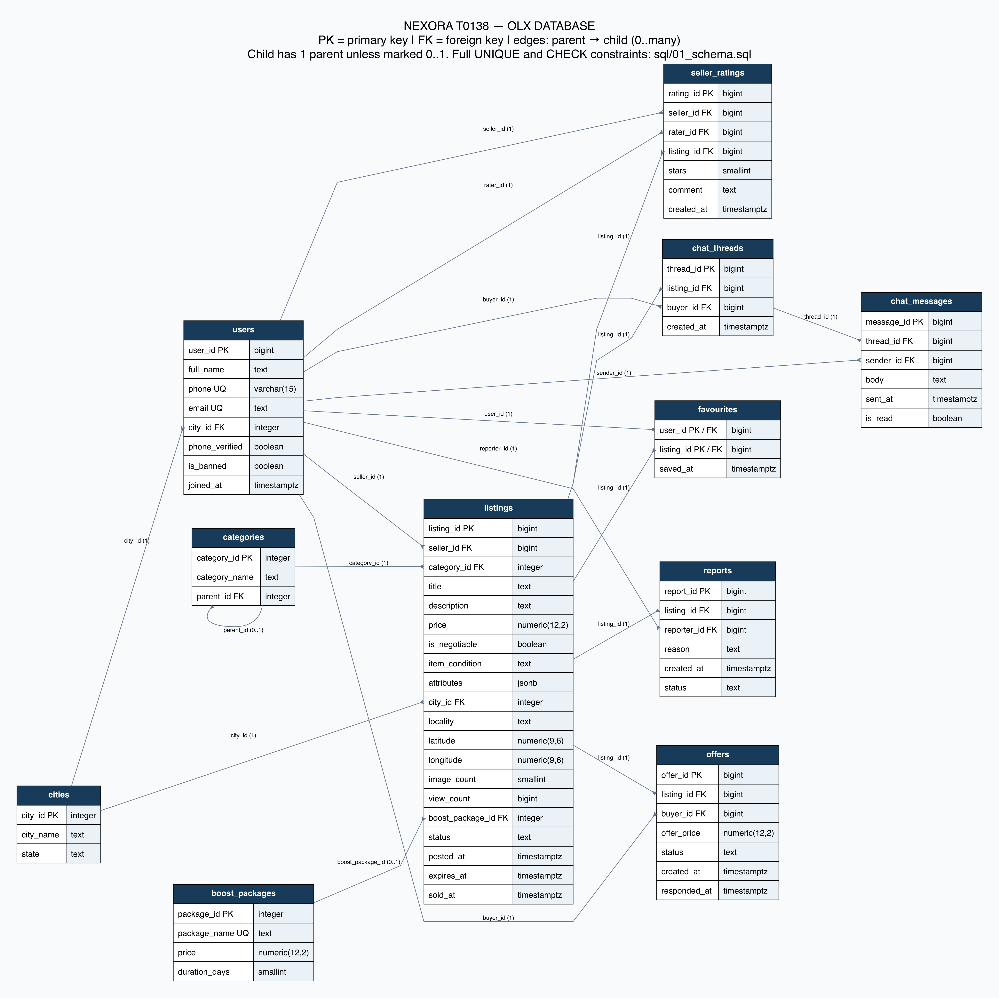

# Schema design and validation

Team T0138 · Nexora · Section D

## Evidence and design approach

Designed from all 11 instructor CSV exports and checked against the unchanged 30-query workload. Names and column order follow the export. The scripts target PostgreSQL 15 or newer. Validation here used **PostgreSQL 18.6 through PGlite 0.5.16**, an embedded WebAssembly build, because native `psql` is unavailable on this machine. This is a correctness check, not CP2 timing evidence. Re-run the provided psql commands on the team's benchmark laptop.

Source: [assigned starter repository](https://github.com/edusatyaki/DBMS-OLX-Buy-Sell). Starter workload and benchmark script remain unchanged. No other team's work was used.

## Types, keys and constraints

IDs for growing tables use bigint; small catalogs use integer. Currency uses numeric(12,2), coordinates numeric(9,6), flags boolean and instants timestamptz. Text is used for variable-length names and messages, rather than arbitrary truncation limits. IDs are supplied explicitly, matching the CSV and write workload; the application must allocate them. Future identity sequences would need to start above loaded IDs.

Below, PRIMARY KEY implies NOT NULL. Table-level constraints are listed after the dictionary; the SQL is the executable definition.

### cities

| Column | Type | Column constraints / defaults | Reason |
|---|---|---|---|
| `city_id` | `integer` | `PRIMARY KEY` | City reference; listing city may differ from the seller home city. |
| `city_name` | `text` | `NOT NULL CHECK (btrim(city_name) <> '')` | City label, unique together with state. |
| `state` | `text` | `NOT NULL CHECK (btrim(state) <> '')` | State label; not derived from the spelling of a city name. |

### categories

| Column | Type | Column constraints / defaults | Reason |
|---|---|---|---|
| `category_id` | `integer` | `PRIMARY KEY` | Category reference or identifier. |
| `category_name` | `text` | `NOT NULL CHECK (btrim(category_name) <> '')` | Category label; no global uniqueness assumed. |
| `parent_id` | `integer` | `REFERENCES categories(category_id) ON DELETE RESTRICT` | Optional parent; NULL identifies a root category. |

### boost_packages

| Column | Type | Column constraints / defaults | Reason |
|---|---|---|---|
| `package_id` | `integer` | `PRIMARY KEY` | Boost package identifier. |
| `package_name` | `text` | `NOT NULL UNIQUE CHECK (btrim(package_name) <> '')` | Unique catalog name. |
| `price` | `numeric(12,2)` | `NOT NULL CHECK (price > 0)` | Exact decimal currency amount; no floating-point rounding. |
| `duration_days` | `smallint` | `NOT NULL CHECK (duration_days > 0)` | Positive package lifetime in whole days. |

### users

| Column | Type | Column constraints / defaults | Reason |
|---|---|---|---|
| `user_id` | `bigint` | `PRIMARY KEY` | User identifier; a person can buy and sell. |
| `full_name` | `text` | `NOT NULL CHECK (btrim(full_name) <> '')` | Display name, intentionally not unique. |
| `phone` | `varchar(15)` | `NOT NULL UNIQUE CHECK (phone ~ '^[0-9]{10,15}$')` | Login key kept as text to preserve leading digits. |
| `email` | `text` | `UNIQUE` | Optional unique contact; multiple NULLs allowed, comparison is case-sensitive. |
| `city_id` | `integer` | `NOT NULL REFERENCES cities(city_id) ON DELETE RESTRICT` | City reference; listing city may differ from the seller home city. |
| `phone_verified` | `boolean` | `NOT NULL DEFAULT false` | Verification flag. |
| `is_banned` | `boolean` | `NOT NULL DEFAULT false` | Access control flag. |
| `joined_at` | `timestamptz` | `NOT NULL DEFAULT CURRENT_TIMESTAMP` | Signup instant with timezone. |

### listings

| Column | Type | Column constraints / defaults | Reason |
|---|---|---|---|
| `listing_id` | `bigint` | `PRIMARY KEY` | Listing identifier or foreign-key reference. |
| `seller_id` | `bigint` | `NOT NULL REFERENCES users(user_id) ON DELETE RESTRICT` | Owner reference; in ratings retained for workload compatibility. |
| `category_id` | `integer` | `NOT NULL REFERENCES categories(category_id) ON DELETE RESTRICT` | Category reference or identifier. |
| `title` | `text` | `NOT NULL CHECK (btrim(title) <> '')` | Search/display text, not a unique item key. |
| `description` | `text` | `NULL permitted` | Optional listing detail. |
| `price` | `numeric(12,2)` | `NOT NULL CHECK (price >= 0)` | Exact decimal currency amount; no floating-point rounding. |
| `is_negotiable` | `boolean` | `NOT NULL DEFAULT true` | Negotiation flag; default needed when W01 omits it. |
| `item_condition` | `text` | `NOT NULL CHECK (item_condition IN ('NEW','LIKE_NEW','GOOD','FAIR'))` | Finite condition domain from export. |
| `attributes` | `jsonb` | `NOT NULL DEFAULT '{}'::jsonb CHECK (jsonb_typeof(attributes) = 'object')` | Category-specific JSON object; treated as a document-valued attribute. |
| `city_id` | `integer` | `NOT NULL REFERENCES cities(city_id) ON DELETE RESTRICT` | City reference; listing city may differ from the seller home city. |
| `locality` | `text` | `NOT NULL CHECK (btrim(locality) <> '')` | Free-form location label; not a reliable city determinant. |
| `latitude` | `numeric(9,6)` | `NOT NULL CHECK (latitude BETWEEN -90 AND 90)` | Six decimal places; geographic latitude bounds. |
| `longitude` | `numeric(9,6)` | `NOT NULL CHECK (longitude BETWEEN -180 AND 180)` | Six decimal places; geographic longitude bounds. |
| `image_count` | `smallint` | `NOT NULL DEFAULT 0 CHECK (image_count BETWEEN 0 AND 12)` | Photo count only; maximum 12 is a chosen business limit (observed maximum 11). |
| `view_count` | `bigint` | `NOT NULL DEFAULT 0 CHECK (view_count >= 0)` | Nonnegative stored counter, default zero for W01. |
| `boost_package_id` | `integer` | `REFERENCES boost_packages(package_id) ON DELETE RESTRICT` | NULL means no boost, not an invalid/missing package. |
| `status` | `text` | `NOT NULL DEFAULT 'ACTIVE' CHECK (status IN ('ACTIVE','SOLD','EXPIRED','REMOVED'))` | Finite lifecycle domain as listed in SQL. |
| `posted_at` | `timestamptz` | `NOT NULL DEFAULT CURRENT_TIMESTAMP` | Posting instant. |
| `expires_at` | `timestamptz` | `NOT NULL` | Expiry must follow posting; no fixed 30-day CHECK assumed. |
| `sold_at` | `timestamptz` | `NULL permitted` | Present exactly for SOLD listings, never before posting. |

### chat_threads

| Column | Type | Column constraints / defaults | Reason |
|---|---|---|---|
| `thread_id` | `bigint` | `PRIMARY KEY` | Conversation identifier or reference. |
| `listing_id` | `bigint` | `NOT NULL REFERENCES listings(listing_id) ON DELETE RESTRICT` | Listing identifier or foreign-key reference. |
| `buyer_id` | `bigint` | `NOT NULL REFERENCES users(user_id) ON DELETE RESTRICT` | Buyer user reference. |
| `created_at` | `timestamptz` | `NOT NULL DEFAULT CURRENT_TIMESTAMP` | Creation instant. |

### chat_messages

| Column | Type | Column constraints / defaults | Reason |
|---|---|---|---|
| `message_id` | `bigint` | `PRIMARY KEY` | Message identifier. |
| `thread_id` | `bigint` | `NOT NULL REFERENCES chat_threads(thread_id) ON DELETE RESTRICT` | Conversation identifier or reference. |
| `sender_id` | `bigint` | `NOT NULL REFERENCES users(user_id) ON DELETE RESTRICT` | Sender user reference; participant rule audited separately. |
| `body` | `text` | `NOT NULL CHECK (btrim(body) <> '')` | Nonblank message content. |
| `sent_at` | `timestamptz` | `NOT NULL DEFAULT CURRENT_TIMESTAMP` | Message instant. |
| `is_read` | `boolean` | `NOT NULL DEFAULT false` | Read flag; false default supports W03. |

### offers

| Column | Type | Column constraints / defaults | Reason |
|---|---|---|---|
| `offer_id` | `bigint` | `PRIMARY KEY` | Offer identifier; repeated offers from a buyer are allowed. |
| `listing_id` | `bigint` | `NOT NULL REFERENCES listings(listing_id) ON DELETE RESTRICT` | Listing identifier or foreign-key reference. |
| `buyer_id` | `bigint` | `NOT NULL REFERENCES users(user_id) ON DELETE RESTRICT` | Buyer user reference. |
| `offer_price` | `numeric(12,2)` | `NOT NULL CHECK (offer_price > 0)` | Strictly positive exact offer amount. |
| `status` | `text` | `NOT NULL DEFAULT 'PENDING' CHECK (status IN ('PENDING','ACCEPTED','REJECTED','COUNTERED'))` | Finite lifecycle domain as listed in SQL. |
| `created_at` | `timestamptz` | `NOT NULL DEFAULT CURRENT_TIMESTAMP` | Creation instant. |
| `responded_at` | `timestamptz` | `NULL permitted` | NULL exactly when pending; otherwise at or after creation. |

### favourites

| Column | Type | Column constraints / defaults | Reason |
|---|---|---|---|
| `user_id` | `bigint` | `NOT NULL REFERENCES users(user_id) ON DELETE CASCADE` | User identifier; a person can buy and sell. |
| `listing_id` | `bigint` | `NOT NULL REFERENCES listings(listing_id) ON DELETE CASCADE` | Listing identifier or foreign-key reference. |
| `saved_at` | `timestamptz` | `NOT NULL DEFAULT CURRENT_TIMESTAMP` | When this user saved this listing. |

### reports

| Column | Type | Column constraints / defaults | Reason |
|---|---|---|---|
| `report_id` | `bigint` | `PRIMARY KEY` | Report identifier. |
| `listing_id` | `bigint` | `NOT NULL REFERENCES listings(listing_id) ON DELETE RESTRICT` | Listing identifier or foreign-key reference. |
| `reporter_id` | `bigint` | `NOT NULL REFERENCES users(user_id) ON DELETE RESTRICT` | Reporting user reference. |
| `reason` | `text` | `NOT NULL CHECK (reason IN ('SPAM','FRAUD','OFFENSIVE','WRONG_CATEGORY','ALREADY_SOLD'))` | Finite moderation reason domain. |
| `created_at` | `timestamptz` | `NOT NULL DEFAULT CURRENT_TIMESTAMP` | Creation instant. |
| `status` | `text` | `NOT NULL DEFAULT 'OPEN' CHECK (status IN ('OPEN','ACTIONED','DISMISSED'))` | Finite lifecycle domain as listed in SQL. |

### seller_ratings

| Column | Type | Column constraints / defaults | Reason |
|---|---|---|---|
| `rating_id` | `bigint` | `PRIMARY KEY` | Rating identifier. |
| `seller_id` | `bigint` | `NOT NULL REFERENCES users(user_id) ON DELETE RESTRICT` | Owner reference; in ratings retained for workload compatibility. |
| `rater_id` | `bigint` | `NOT NULL REFERENCES users(user_id) ON DELETE RESTRICT` | Reviewing user, different from seller. |
| `listing_id` | `bigint` | `NOT NULL REFERENCES listings(listing_id) ON DELETE RESTRICT` | Listing identifier or foreign-key reference. |
| `stars` | `smallint` | `NOT NULL CHECK (stars BETWEEN 1 AND 5)` | Integer rating from 1 to 5. |
| `comment` | `text` | `NULL permitted` | Optional rating text. |
| `created_at` | `timestamptz` | `NOT NULL DEFAULT CURRENT_TIMESTAMP` | Creation instant. |

## Relationships, uniqueness and deletion



Editable sources: [Mermaid](../diagrams/er_diagram.mmd), [Graphviz](../diagrams/er_diagram.dot). Each reference is many-to-one: a child has exactly one parent unless its FK is nullable; a parent can have zero or more children. Categories have an optional parent, and listings an optional boost. Users and listings have an M:N saved-listing relationship via favourites. A user may have both buyer and seller roles without separate duplicated user records.

- Unique `(city_name, state)` disambiguates same-named cities across states. Package names and phone numbers are unique. Optional email values are unique when supplied.
- Threads: unique `(listing_id, buyer_id)` prevents duplicate conversations.
- Favourites: composite primary key `(user_id, listing_id)` prevents duplicate saves.
- Reports: unique `(listing_id, reporter_id)` models one report per user per ad.
- Ratings: unique `(listing_id, rater_id)` models one review per rater per listing. An offer has no such uniqueness rule because negotiation can involve repeated offers.
- Foreign keys use RESTRICT to protect catalog, conversation, transaction and moderation history. An ad is normally marked REMOVED and a user banned, rather than physically deleted. Only favourites use CASCADE, since a saved link has no independent meaning after its user or listing is deleted. All updates use PostgreSQL's default NO ACTION; identifiers are stable.
- Category self-parenting is rejected. Longer category cycles need a recursive audit or application validation; the FK alone does not prevent them.
- Sold status and sold_at presence are equivalent; sale cannot predate posting. Pending offer status and missing response are equivalent; a response cannot predate the offer. Images, coordinates, prices, counts, JSON object shape, nonblank labels, status/reason domains and rating bounds have explicit CHECK constraints (more than the required 12).
- Cross-table rules such as sender participation and rating seller consistency cannot be expressed by a simple row CHECK. They are audited below and must be enforced by future application transactions or triggers. CP1 adds no triggers or tuning indexes.

## Functional dependencies and normalization

Dependencies below are business assumptions, not conclusions drawn just because values happen to be unique in this export. City name alone, full name, title, locality, price and status do not identify records.

| Relation | Candidate keys | Nontrivial dependencies | Normal form |
|---|---|---|---|
| cities | city_id; (city_name, state) | city_id → city_name, state; (city_name, state) → city_id | BCNF |
| categories | category_id | category_id → category_name, parent_id | BCNF |
| boost_packages | package_id; package_name | each candidate key → all remaining attributes | BCNF |
| users | user_id; phone | user_id → remaining attributes; phone → remaining attributes | BCNF under stated dependencies; nullable email is a conditional unique identifier, not a relational candidate key |
| listings | listing_id | listing_id → all remaining attributes | BCNF at the document-valued attribute level |
| chat_threads | thread_id; (listing_id, buyer_id) | each candidate key → all remaining attributes | BCNF |
| chat_messages | message_id | message_id → all remaining attributes | BCNF |
| offers | offer_id | offer_id → all remaining attributes | BCNF |
| favourites | (user_id, listing_id) | (user_id, listing_id) → saved_at | BCNF |
| reports | report_id; (listing_id, reporter_id) | each candidate key → all remaining attributes | BCNF |
| seller_ratings | rating_id; (listing_id, rater_id) | each candidate key → remaining attributes; listing_id → seller_id | 1NF; fails 2NF, 3NF and BCNF under the business dependency listing_id → seller_id |

A relation is in 1NF when each field holds one value and repeating records are separated. In 2NF, no non-key attribute depends on only part of any candidate key. In 3NF, every nontrivial FD has a superkey determinant or a prime dependent; BCNF requires every nontrivial determinant to be a superkey.

For `seller_ratings`, `listing_id → seller_id` is a real redundancy: listing_id is not a key because different raters may review the same listing. It is a proper subset of `(listing_id, rater_id)`. A strictly normalized design removes seller_id from ratings and derives it through listings (the listings table already supplies that dependency), giving a lossless decomposition. We retain the exported seller_id because the fixed workload reads it directly, explicitly acknowledge the normal-form exception, and audit equality with the listing owner. A later application must update owner-related data atomically or disallow ownership changes.

`chat_threads` correctly omits seller_id: the seller is obtained from its listing. `listings.city_id` is an ad's location and need not equal the seller's home city. `view_count` is a stored aggregate counter; there is no page-view event table in this export from which to reconstruct it. It does not by itself violate the listed FDs but requires atomic updates. JSONB attributes are kept to support the supplied JSON queries; BCNF claims concern the relation's top-level columns, not an assertion that arbitrary nested JSON is a fully normalized relational design. A category-specific child-table decomposition could be considered later.

## NULLs and observed limitations

CSV unquoted empty fields load as NULL. The optional fields are categories.parent_id, users.email, listings.description/boost_package_id/sold_at, offers.responded_at and seller_ratings.comment. All other exported fields are required. Parentless categories are roots; unboosted ads have no package; unsold ads have no sale instant; pending offers have no response yet. Descriptions, emails and comments may simply be absent.

No row needed to be deleted or rewritten to satisfy this schema. Exact NULL counts: email 24,885; description 23,737; boost_package_id 110,565; sold_at 76,431; responded_at 162; comment 5,589; parent_id 5. Semantic cautions remain: generated locality labels are not a geographic authority (for example listing 1 combines city_id 5 with locality Andheri), and product brand/title combinations are not guaranteed to represent real products. We preserve the export and do not add invented locality→city or brand→model dependencies.

R13's NOT IN subquery includes NULL boost IDs, which can suppress all results. Do not turn missing boosts into fake package IDs to mask this query issue; investigate it during the optimization checkpoint. Lifecycle status is historical snapshot data, not recalculated from the current calendar date.

## Reproducible validation

From repository root, with PostgreSQL 15+ and its CLI installed:

```sh
unzip -n seed_data.zip
createdb nexora_olx
psql -X -v ON_ERROR_STOP=1 -d nexora_olx -f sql/01_schema.sql
psql -X -v ON_ERROR_STOP=1 -d nexora_olx -f sql/02_load_data.sql
```

Use a new empty database. Schema creation intentionally does not DROP existing work. The data load is transactional and stops on the first error; do not rerun it on populated tables. Relative CSV paths assume the repository root. The loader automatically executes sql/03_validate_data.sql after loading and ANALYZE. `psql` backslash commands were adapted to PGlite COPY with the identical CSV bytes for the recorded validation; native CLI execution remains to be checked on the benchmark laptop.

### Observed row counts

| Table | Expected | Loaded | Difference |
|---|---:|---:|---:|
| cities | 10 | 10 | 0 |
| categories | 12 | 12 | 0 |
| boost_packages | 6 | 6 | 0 |
| users | 50,000 | 50,000 | 0 |
| listings | 120,000 | 120,000 | 0 |
| chat_threads | 59,855 | 59,855 | 0 |
| chat_messages | 209,529 | 209,529 | 0 |
| offers | 19,943 | 19,943 | 0 |
| favourites | 70,000 | 70,000 | 0 |
| reports | 7,999 | 7,999 | 0 |
| seller_ratings | 11,244 | 11,244 | 0 |

### Observed integrity checks

| Check | Violations |
|---|---:|
| chat_buyer_is_seller | 0 |
| message_sender_not_participant | 0 |
| sold_before_posted | 0 |
| rating_seller_mismatch | 0 |
| offer_buyer_is_seller | 0 |
| message_before_thread | 0 |
| rating_before_sale | 0 |

All 25 reads successfully planned using EXPLAIN; all five writes executed separately inside BEGIN/ROLLBACK. Read execution times were not measured. Raw correctness evidence: [validation JSON](cp1_validation.json), [workload check](cp1_workload_check.txt).

### Baseline indexes

Only these automatically created PK/UNIQUE indexes exist; foreign keys alone do not create indexes in PostgreSQL:

- `boost_packages_package_name_key`
- `boost_packages_pkey`
- `categories_pkey`
- `chat_messages_pkey`
- `chat_threads_listing_id_buyer_id_key`
- `chat_threads_pkey`
- `cities_city_name_state_key`
- `cities_pkey`
- `favourites_pkey`
- `listings_pkey`
- `offers_pkey`
- `reports_listing_id_reporter_id_key`
- `reports_pkey`
- `seller_ratings_listing_id_rater_id_key`
- `seller_ratings_pkey`
- `users_email_key`
- `users_phone_key`
- `users_pkey`
